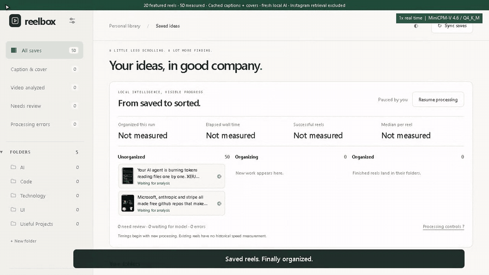

# Reelbox

Find the Instagram reels you saved.

Reelbox collects links from Instagram Saved through a Chromium extension. It sorts them into topic folders you can browse and search on your computer.

## See it organize real reels

[](docs/media/reelbox-demo.mp4)

[Watch the captioned demo](docs/media/reelbox-demo.mp4) · [Measured results](docs/BENCHMARK.md) · [Recording guide](docs/DEMO.md)

Watch one reel move into its topic folder while MiniCPM-V 4.6 organizes a sample of 50 GitHub, AI and technology saves. The panel shows progress and processing speed. This run used cached captions and covers, so its timing excludes Instagram retrieval. The [benchmark](docs/BENCHMARK.md) explains the setup and what was measured.

## What it does

- Browse thumbnail cards or a list, with light and dark themes.
- Search source text or use semantic retrieval.
- Organize reels into broad folders; custom folder descriptions can match existing analyzed reels in the background.
- Start analysis with title, caption and cover. Video downloads require approval for each reel.
- Show whether evidence comes from captions/covers or sampled frames and speech.
- Preserve queued work, Stop/Resume state and verification pauses across restarts.
- Follow a reel through Unorganized → Organizing → its topic folder, with durable timing and successful-reel throughput.

MiniCPM-V 4.6 (`minicpm-v4.6:latest`) handles vision, writing and routing locally. `nomic-embed-text` supports search and topic retrieval. D1 is available as an optional decision model. Model scores are estimates; they have not been calibrated against a labeled test set.

## Requirements

The documented setup targets Windows with Python 3.11, [Ollama](https://ollama.com/download), [FFmpeg](https://ffmpeg.org/download.html) and Chrome, Edge or Brave. Put both `ffmpeg` and `ffprobe` on PATH. Local vision models require substantial memory; speed depends on your hardware. Node.js is optional, for extension tests only.

Instagram access needs an account signed into your normal browser. Initial model downloads and Instagram access require the internet.

## Install

Download and extract this repository, or clone [Sambhav242005/Reelbox](https://github.com/Sambhav242005/Reelbox). Open PowerShell in its root folder.

```powershell
py -3.11 -m venv .venv
.\.venv\Scripts\python.exe -m pip install -r app/requirements.txt
ollama pull minicpm-v4.6:latest
ollama pull nomic-embed-text
ffmpeg -version
ffprobe -version
```

Keep Ollama running. If its desktop service is not running, use `ollama serve` in another terminal. These commands follow the [Ollama CLI reference](https://github.com/ollama/ollama/blob/main/docs/cli.mdx). `requirements-lock.txt` records the development environment; the minimal requirements file above is the normal installation path.

## Start and connect

1. Double-click **Start Reelbox.cmd**, or run the command below.
2. Open [the dashboard](http://127.0.0.1:8765/). Serve it through the backend; opening the HTML file directly does not work.
3. Open your browser's extensions page: `chrome://extensions`, `edge://extensions` or `brave://extensions`.
4. Enable **Developer mode**, select **Load unpacked**, and choose `app/extension`.
5. In that browser profile, open Instagram → your profile → **Saved**.
6. Click the extension and select **Connect this Saved page**, then **Sync now**.

```powershell
.\.venv\Scripts\python.exe app/launch.py --open
```

The backend and browser must both be running for collection. The extension attempts a daily scan while the browser is open. Use one Instagram profile per library. See [extension details](app/extension/README.md) for permissions and scan behavior.

## Use your library

Browse folders and reel cards, search, and open a reel for its evidence and original Instagram link. Create a folder with a name and description to start additive matching against existing analyzed reels. Manual folder links are preserved during later analysis.

Use **Analyze video** or **Approve video analysis** only when you want deeper evidence for that reel. Approved video processing uses temporary downloads, sampled frames and local speech transcription; it does not establish that every moment was watched. Faster-Whisper downloads its speech model on first use.

Use **Stop processing** and **Resume processing** to control background analysis. New libraries default to a 50-reel verification batch; inspect the results and select **Continue next 50**. Settings also offer other batch sizes and Unlimited. The application currently admits up to five reel workers; Ollama controls actual inference scheduling.

## Configuration, privacy and troubleshooting

See [the usage guide](docs/USAGE.md), [contributing](CONTRIBUTING.md) and [security](SECURITY.md).

The dashboard, database and default model inference stay local. Instagram requests still leave your computer. The extension passes Instagram session cookies to the local backend for authenticated retrieval; cookies and API tokens are never model evidence. Explicit remote model endpoints can send captions, images and transcripts off your computer.

This is an experimental local project and an unpacked extension, not a store-reviewed release. Automated tests use temporary data and simulated responses. Complete real-account Saved coverage and categorization accuracy are not established; layout changes, expired sessions and throttling can interrupt collection. Capped scans are partial.

## Repository layout

Project documents: [specification](docs/spec.md), [project structure](docs/project-structure.md), [agent instructions](AGENTS.md), [decision contract](decision.md), and [interface design](design.md).

```text
app/                 Python backend, local dashboard and Chromium extension
tests/               Backend tests and simulated extension checks
docs/USAGE.md        Configuration and troubleshooting
docs/spec.md         Product specification
docs/project-structure.md  Repository map and implementation boundaries
AGENTS.md            Contributor and agent instructions
README.md            Installation and first use
CONTRIBUTING.md      Development checks
SECURITY.md          Sensitive data and reporting guidance
Start Reelbox.cmd    Portable Windows launcher
```

Private runtime files are created in `app/data/` and ignored by Git. No license grant has been selected for this project; do not assume reuse permissions from public availability.
